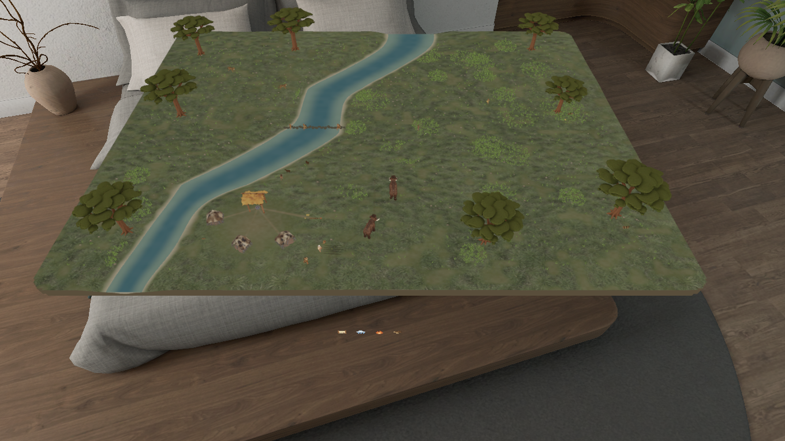

# 桌角文明

**俯身一看，万物正在生活。**

像《God: Serengeti》中的上帝一样，俯瞰眼前的微缩世界。

一款为 PICO MR 头戴设备开发的微缩生态沙盘。村民采集、搬运、耕作、修屋，累了走进棚子坐下休息。猛犸结伴觅食，幼象偶尔离群，剑齿虎伺机捕食。降雨、点火与投放木材会影响世界中的人和动物。村落见闻画卷记录自主事件和玩家触发的变化。



## 构建

需要 JDK 17 或更新版本、Android SDK 35、可获取项目所声明 PICO Spatial SDK 6.2.8 依赖的 Maven 环境，以及 Git LFS。

```sh
git lfs install
git lfs pull
./gradlew :app:assembleLivingAcceptance
./gradlew :app:testLivingAcceptanceUnitTest
```

体验包输出到 app/build/outputs/apk/livingAcceptance/，应用入口为「桌角文明 远古体验」。正式发布可构建 assembleRelease，签名通过 CORNER_RELEASE_KEYSTORE、CORNER_RELEASE_STORE_PASSWORD、CORNER_RELEASE_KEY_ALIAS、CORNER_RELEASE_KEY_PASSWORD 环境变量配置。

## 当前版本

V17.5 原型。399 项 JVM 测试通过，原生峰值 691,777 三角面，目标预算 800,000。此前已在 PICO Swan 真机和模拟器进行专项玩法验证。构建脚本保留工程现有依赖仓库配置，外部构建环境需要可访问这些依赖。

VibeLab 发布配置位于 vibelab.yaml，图标与游戏截图位于 release/。截图来自 V17.5 模拟器，已按发布尺寸裁切与缩放。
